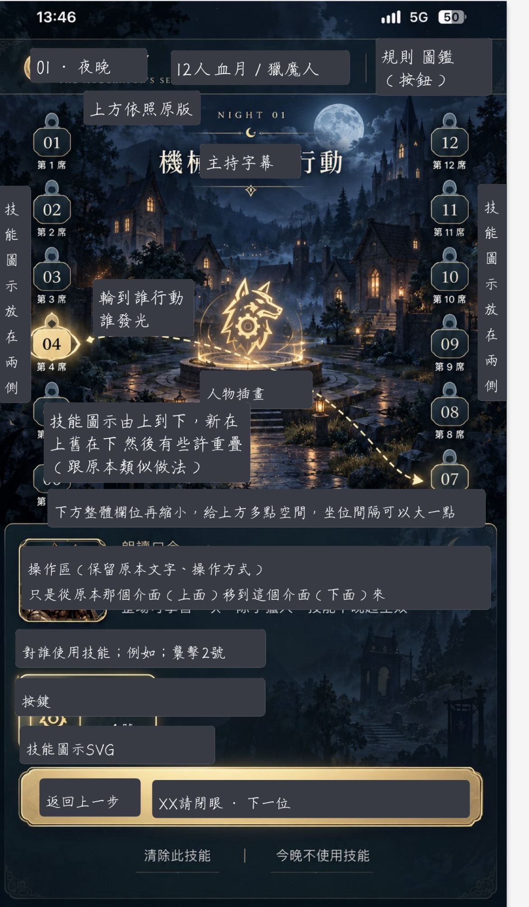

# 月下議會｜DESIGN.md

> **設計文件 v1.0（第一版初稿）｜2026-10-15**
>
> **狀態：設計方向與現況基線，不代表程式已實作或真機已驗收。**  
> GitHub `feat/eclipse-host-app` 的實際 HTML／CSS／JavaScript 是現況依據；本文件定義後續 UI 設計方向，不會自行改變既有功能。

## 1. 文件目的及來源

本版整合：
1. **現有 App**：`public/index.html`、`public/style.css`、`public/app.js` 與既有美術素材。
2. **2026-10-15 使用者提供的標註草圖**：以既有深藍月夜村莊背景與金色視覺語言為基礎，探索主持頁的資訊位置及上下層級。
3. **可執行邊界**：本版僅產出設計規格與參考素材；任何 UI 改版須另行批准、實作、測試。

### 設計參考圖

- GitHub 相對路徑：`docs/design/host-ui-reference-v1.jpeg`（方便 Codex 與 PR 直接比對）。
- Google Drive 備份：[月下議會 / Design.md / host-ui-reference-v1.jpeg](https://drive.google.com/file/d/1OEF6aPr4p6s1eMhjKXxHKtpFeSaPoju2/view)。
- Google Drive 設計資料夾：[月下議會 / Design.md](https://drive.google.com/drive/folders/1lbn2KWH3ZGOv2dvkiVPxJXvd4JC5bwII)。
- **草圖上灰色框與手寫說明是「位置註解」，不是要在正式 UI 顯示的標籤或按鈕文案。** 草圖不是精確尺寸稿；操作文案、狀態與互動一律先依現有程式及正式遊戲規格。

## 2. 整體視覺方向

**氛圍**：深藍、夜晚、月光、村莊、金色微光的奇幻感；以主持時的可辨識性優先，而非以裝飾遮蔽資訊。保留既有品牌「月下議會」、原場景素材和目前可使用的玻璃質感卡片／金色重點提示。

**視覺層級**：
1. 主持階段與當局板子（快速確認）。
2. 本步正式主持字幕（最高文字閱讀優先）。
3. 座位與互動狀態（保持一目了然、可點擊）。
4. 操作提示、技能操作與手勢圖（法官輔助資訊）。
5. 底部主要流程按鈕、次要操作入口。
6. 場景背景和裝飾（不得搶走文字與點擊焦點）。

## 3. 現況設計 Token（取自現有 style.css；暫不重新定色）

| Token | 現況值 | 用途 |
| --- | --- | --- |
| `--bg` | `#0D1424` | 底色 |
| `--panel` | `#161d30` | 內容面板 |
| `--purple` | `#302440` | 次要按鈕／標籤 |
| `--gold` | `#B99A62` | 重要點綴與描邊 |
| `--ink` | `#ebe9e6` | 主文字 |
| `--muted` | `#a5aabc` | 次要文字 |
| `--line` | `#384058` | 邊框／分隔 |
| `--wolf` | `#ed8585` | 狼人角色提示 |
| `--god` | `#d4b67b` | 神職角色提示 |
| `--civil` | `#d6d9e1` | 平民狀態色 |
| `--green` | `#6fcf97` | 既有部分平民／成功語意 |

- 現有字型基底：`system-ui, "Microsoft JhengHei", sans-serif`；品牌標題另有襯線字型。**草圖中的書法體僅代表氣氛，不直接取代操作字幕字型。**
- 現有按鈕基準最小高度為 44px；部分受空間限制的主持輔助按鈕已有例外。新設計需重新驗收真實觸控區，不盲目縮小。
- 重要角色狀態不能只靠顏色辨認，保留原本文字、框線或技能 SVG 的語意。

## 4. 主持頁：第一版分區提案

### A. 頂部資訊列

- 維持現有 `#phase`、`#boardName`、`#rulesOpen`、`#hostLibrary` 的資訊與功能。
- 視覺參考圖：左為日夜／階段，中為人數及板子名稱，右為「規則」「圖鑑」；窄螢幕可調整排列，但不得截斷重要板子名稱或遮住按鈕。
- **不在本版調整顯示文案、回到原版頁面、或圖鑑的實際操作流程。**

### B. 主持字幕

- 沿用既有 `#stepLabel`、`#subtitle`、`#hint`、`#selection` 來源。
- 草圖中字幕置於主要視覺區上段，必須提高文字對比；長句換行不可撞到座位、背景裝飾或其他操作。
- 正式字幕文字及出現時機以現有遊戲流程為準。不可為了配合視覺範例改寫成「機械狼行動」等新文案。

### C. 座位環與視覺核心

- 保留目前由 `#left`、`#right` 及 `.seats` 建立的**左右兩欄、每欄六個座位**及全部玩家狀態。
- 草圖希望座位更接近背景左右側的直向排列，中間留給月夜／狼徽／視覺核心；**此為後續版面探索方向，尚未批准變更座位 DOM、順序或事件。**
- 角色身分／出局／警上／退水／投票選取／目前發言／技能標記等可見資訊與操作回饋不得因透明化而消失。
- 狼徽或中央裝飾只屬視覺素材，不可變成操作熱區、角色圖示或擋住可點擊座位。
- 座位角色與技能 SVG 仍由原資料與狀態驅動；草圖不表示重新產生人物素材。

### D. 技能圖示

- 沿用目前 `.skill-marks` 和技能 SVG 顯示邏輯、使用時機與排列語意。
- 草圖中的「技能圖示放在兩側」是**視覺方向**，優先評估左右座位的邊緣對齊、遮擋、重疊、短螢幕安全距離；實際重新定位須另行確認。
- 禁止僅為 UI 美化而修改正式技能 SVG 檔案位元組或技能狀態。

### E. 操作區（草圖下半部）

- 使用既有 `.judge-box`、`#operationCard`、`#gestureResult`、`#selection`、`#actions` 的真實文字與互動，不額外創作行為。
- 草圖期望法官操作區移到主持主要場景下方、保留文字與操作方式；**第一版只記錄為待驗證的結構性調整**。現況依然在 `.host-center` 內。
- 運作中的行為：選擇玩家、技能操作、空過、確認等，以原有遊戲流程及當前可見控制為準。
- 若改成下方操作區，需評估捲動容器與按鈕可見性；不得使「下一步」與選擇目標發生遮擋。

### F. 底部操作與導覽

- 保留 `#host > footer` 的現有輔助入口，以及 `#back`／`#next` 的原功能。
- 草圖的金色邊框為氛圍參考；**不得因視覺稿而擅自新增總控面板或刪除既有入口。**
- 現有浮動半透明按鈕與主動作強調狀態應維持可辨認、可按、可聚焦。

## 5. 其他介面的一致性（先沿用現有）

- 首頁與選板、設定、圖鑑、投票視窗、計時器、結束與復盤：第一版不全面重繪。
- 角色圖鑑維持正式圖片與翻卡互動；復盤仍使用既有角色插畫的整卡融合樣式。
- 所有 `dialog` 的開關、表單控制、計時、投票與重置動作保持原行為。需要調整視覺時先對應現有元件，而非另建平行 UI。
- 現有 `public/art/backgrounds/shared.png` 等專案素材應作為主要來源；新素材須單獨批准，不以標註草圖取代正式美術。

## 6. 手機、Safari 與可及性

設計時應測試至少：320×568、375×667、390×844、430×932、短螢幕、桌面較寬版面。這些是**測試 viewport，不是通過的驗收結果**。

- 必須處理 `viewport-fit=cover`、`env(safe-area-inset-*)`、`visualViewport`、瀏覽器工具列與鍵盤佔用的可視高度。
- 不新增重複的 `100vh`／`100dvh` 強制高度規則，避免手機雙指縮放或背景捲動回歸問題。
- 座位區與下方操作區若分層，優先保證字幕、座位點擊、主要控制與焦點順序；不得產生不可達的按鈕。
- 手機模擬不等於 iPhone Safari／iOS 安裝 PWA／Android 實機驗收。
- 保留 `:focus-visible`、鍵盤操作與 `prefers-reduced-motion` 行為；裝飾動畫不得影響主持計時或遊戲狀態。

## 7. 變更保護邊界

**本設計文件不能授權修改下列項目**：
- 遊戲規則、角色能力、日夜流程、主持字幕文字和時機；
- 計時器狀態機、投票統計、死亡／勝負結算；
- 回退歷史、存檔結構／遷移、離線快取邏輯；
- 既有角色 PNG／SVG 的核准內容、技能圖示意義；
- GitHub 既有備份分支。

後續 Codex 任務需從實際 App 分支讀取現況，建立隔離變更，且**本文件中「視覺方向／待驗證」的段落一律不視為已核准實作需求**。

## 8. 第一版評審與驗收清單

| 項目 | 狀態 | 判斷標準 |
| --- | --- | --- |
| 草圖歸檔 | 已完成 | 原始參考圖在 GitHub 與 Google Drive 可對照 |
| 現有設計 Token 建檔 | 已整理 | 與目前 `style.css` 相符 |
| 上方資訊列／字幕層級 | 待設計確認 | 文字與功能保留，窄螢幕不遮擋 |
| 中央場景／左右座位位置 | 待設計確認 | 保持 2×6、可點擊、完整狀態標記 |
| 左右技能 SVG 排列 | 待設計確認 | 不重疊，不改技能與素材 |
| 下方操作區佈局 | 待設計確認 | 既有操作方式、文案與按鈕可達 |
| 固定底部按鈕與安全區 | 待測試 | 不蓋住操作區，不被系統工具列遮擋 |
| 瀏覽器視覺回歸 | 未執行 | 對照修改前後截圖 |
| iPhone Safari／PWA／Android 真機 | 未執行 | 完整流程操作、縮放、背景切換 |

### 後續工作順序

1. 先用目前實際主持頁截圖與本草圖並排，量測 320／390／430px 版面。
2. 各區塊提出可實作的 UI A/B 方案，逐項確認。
3. 經確認後再開獨立 UI PR；**不要直接按草圖重寫或部署**。
4. 執行自動化測試、截圖回歸與真機驗收；把結果回寫本文。

---
資料來源：使用者提供的 2026-10-15 標註圖，以及 `jia0796/wolf_Emcee` 的 `feat/eclipse-host-app` 當前專案檔案。
