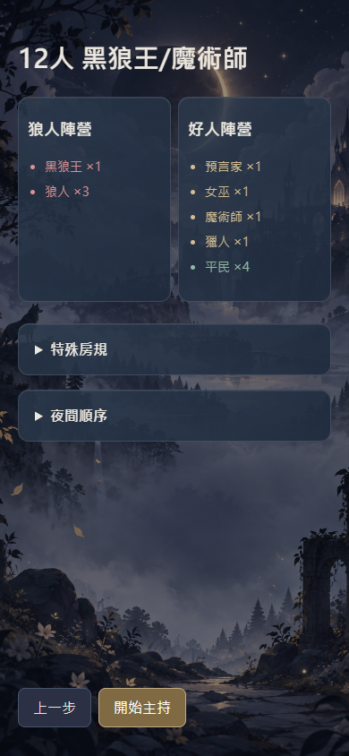
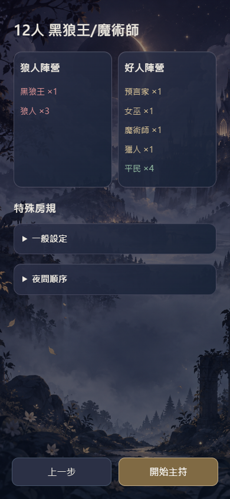
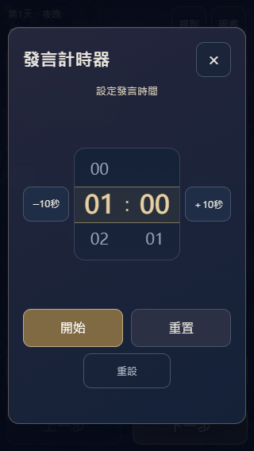

# 月下議會 DESIGN.md 介面改造：本次 PR 報告

日期：2026-10-15。專案：jia0796/wolf_Emcee（原版）。來源 feat/eclipse-host-app@77dedaa5dc2616d88c3986d322d262c210ac5b3a；工作分支 codex/design-md-ui-polish。僅供 PR 確認，未合併、未部署。

## 參考與實作決策

已檢視 [awesome-design-md](https://github.com/VoltAgent/awesome-design-md) 及其 Linear／ElevenLabs 分析入口。採其設計文件方法、克制暗面與清楚層次，沿用月下議會原背景、暗紫藍與古金；實際元件規則見 [DESIGN.md](../DESIGN.md)。沒有安裝外部模板／字型／套件。

原 UI33 分支曾經部署後回退，因此本次從最新 App 隔離作業，不合併舊分支。經比對，最新 App 的 public 與 pre-ui33 基準差異只有最近的19行玻璃控制樣式。重新採用舊分支中符合本次定案的呈現修補（e39dfe8～be2a422），保留最新浮動玻璃按鈕；另整理玻璃深度、圓角、焦點、計時器面板並移除首頁按鈕亮條。舊測試與報告的結論沒有當作本輪測試結果。

最新 DESIGN.md 的懸掛銘牌／中央場景／操作區搬移仍屬提案，本 PR 未納入。UI-13=B、14=B、22=C、25=C、26=B，其他選項照定案。

## 變更範圍

- public/index.html：原房規控制項的呈現分組、夜序分頁容器。
- public/app.js：展示排序與夜序、完整板名、圖鑑位置與焦點、入口防連點、滾輪／動畫呈現；原主持命令與保存流程保留。
- public/recap.js：卡片呈現分類、完整身分圖與details收合；cardModel、outcomeLabel、recapTimeline、finalIdentityModel完全不變。
- public/style.css：八區介面層次與自適應；未加新素材。
- scripts：針對新摺疊容器調整既有瀏覽器開啟方式與捲動檢查，增入UI33、文字放大和保護檔案稽核。未刪單元測試、未改規則斷言。
- DESIGN.md／本報告／證據：供本次審核，未改歷史遊戲規格。

## 修改前保留與安全回退

新增唯讀備份 [backup/pre-design-md-ui-20261015](https://github.com/jia0796/wolf_Emcee/tree/backup/pre-design-md-ui-20261015)，精確指向77dedaa5dc2616d88c3986d322d262c210ac5b3a。原 backup/pre-ui33-20261015@359a66b 也保持不動。本機原 walf 工作目錄與2.0專案的未提交內容未改動。

PR 未合併時關閉 PR 即可，正式版不受影響。若日後合併，對 PR 的合併提交做 git revert 產生反向提交，保留後續歷史；不要 reset／force push 或將舊備份蓋回整個 public。這次沒有存檔遷移，因此 UI 回退不需清 localStorage／sessionStorage 或刪歷史。

## 本輪實跑

| 檢查 | 實際結果 | 證據 |
|---|---|---|
| 修改前 node --test | 791通過／0失敗 | [基準](design-md-ui/baseline-tests.log) |
| 修改後 node --test | 791通過／0失敗；26板各18種子，共468局／51160步 | [完整輸出](design-md-ui/unit-tests.log) |
| UI33情境 | 15組通過、0 pageerror；26板配置／主持、圖鑑、長復盤、計時器等 | [結果](design-md-ui/ui33-scenarios.json) |
| 放大／安全區／reduced-motion | 12組通過、0 pageerror；150%文字、34px安全區、模擬縮放 | [摘要](design-md-ui/accessibility-summary.json) |
| 原有完整瀏覽器回歸 | 36組通過；26板完整對局／2,327步，30角色圖鑑、五尺寸與55項離線資產；0 pageerror | [結果](design-md-ui/regression.json) |
| 保護檔案比對 | 129檔與最新基準相同；4個復盤資料函式相同 | [稽核](design-md-ui/protected-files.json) |
| 差異檢查 | git diff --check | 不含新依賴／部署設定／快取變更 |

UI33涵蓋320×568、375×667、390×844、844×390、320×420。另存修改前後390px首頁／配置／主持／圖鑑及320px計時器。首次啟動瀏覽器在沙箱受限失敗，改用授權的本機瀏覽器執行後通過；不把該次啟動失敗算作產品測試通過。

## 33項逐一對照

「桌面通過」僅表示自動化情境、呈現／資料比對及桌面畫面檢視，不能當作完整真機可用性結論。全部真機欄均待驗收。

| UI | 定案 | 本次呈現 | 桌面證據／檢查 | 狀態 |
|---|---|---|---|---|
| UI-01 | A | 品牌與既有入口 | 首頁截圖／入口測試 | 桌面通過／真機待驗收 |
| UI-02 | A | 暗紫藍古金玻璃 | 首頁及元件截圖 | 桌面通過／真機待驗收 |
| UI-03 | A | 按壓／短轉場與防連點 | 五尺寸、慢渲染雙擊及 reduced-motion | 桌面通過／真機待驗收 |
| UI-04 | A | 原背景及自適應遮罩 | 五尺寸／安全區 | 桌面通過／真機待驗收 |
| UI-05 | A | 原問題回報連結及44px目標 | 入口斷言 | 桌面通過／真機待驗收 |
| UI-06 | A | 10／12人垂直大卡及動態數量 | 26板與資料比對 | 桌面通過／真機待驗收 |
| UI-07 | A | 即點即進與返回 | 入口往返 | 桌面通過／真機待驗收 |
| UI-08 | A | 彈性字級／卡片 | 窄短尺寸／150%文字 | 桌面通過／真機待驗收 |
| UI-09 | A | 完整板名單欄卡 | 資料比對及無橫溢出 | 桌面通過／真機待驗收 |
| UI-10 | A | 一般／特殊分段 | 分類與回頂 | 桌面通過／真機待驗收 |
| UI-11 | A | 清單獨立捲動 | 入口與可達性 | 桌面通過／真機待驗收 |
| UI-12 | A | 狼人／好人雙欄及神職優先 | 26板數量與排序 | 桌面通過／真機待驗收 |
| UI-13 | B | 一般／板子專屬摺疊 | 原預設及選擇保留 | 桌面通過／真機待驗收 |
| UI-14 | B | 條件首夜／次夜分頁 | 原資料順序比對 | 桌面通過／真機待驗收 |
| UI-15 | A | 配置固定雙按鈕 | 短螢幕／放大文字 | 桌面通過／真機待驗收 |
| UI-16 | A | 主持原拓撲／左右六席 | 26板 DOM 及截圖 | 桌面通過／真機待驗收 |
| UI-17 | A | 玻璃座位及原狀態標記 | 回退／多SVG／選取 | 桌面通過／真機待驗收 |
| UI-18 | A | 字幕優先／法官內容可捲 | 長內容與可達性 | 桌面通過／真機待驗收 |
| UI-19 | A | 工具與導覽兩層 | 保留最新浮動玻璃樣式 | 桌面通過／真機待驗收 |
| UI-20 | A | 頂列長板名及入口 | 26板與窄螢幕 | 桌面通過／真機待驗收 |
| UI-21 | A | 選取／正式事件／保存失敗分層 | 保存失敗持續／成功靜默 | 桌面通過／真機待驗收 |
| UI-22 | C | 三欄5:7完整原畫 | 320px三欄及主持範圍 | 桌面通過／真機待驗收 |
| UI-23 | A | 圖鑑一體分類／獨立捲動 | 分類回頂 | 桌面通過／真機待驗收 |
| UI-24 | A | 正反玻璃翻卡／長文捲動 | aria-hidden、inert、拖曳不誤翻 | 桌面通過／真機待驗收 |
| UI-25 | C | 遮罩／鍵盤關閉並回原位 | 分類、捲動及焦點恢復 | 桌面通過／真機待驗收 |
| UI-26 | B | 日夜回合時間軸 | 原recapTimeline計算不變 | 桌面通過／真機待驗收 |
| UI-27 | A | 逐事件及融合原畫 | 原event model不變／完整對局 | 桌面通過／真機待驗收 |
| UI-28 | A | 單一收合身分與三欄卡 | 12人及40回合fixture | 桌面通過／真機待驗收 |
| UI-29 | A | 固定等寬結束按鈕 | 原確認／取消／重開資料保留 | 桌面通過／真機待驗收 |
| UI-30 | A | 設定／倒數雙模式 | 視覺轉場及短屏 | 桌面通過／真機待驗收 |
| UI-31 | A | 中央雙滾輪及±10秒 | 44px行高／進退位／鍵盤 | 桌面通過／真機待驗收 |
| UI-32 | A | 圓環與大數字／提示 | 暫停繼續、時間到 | 桌面通過／真機待驗收 |
| UI-33 | A | 穩定雙向轉場 | 01:30重置／01:00重設／連點／關閉重開 | 桌面通過／真機待驗收 |

## 修改前後畫面

| 畫面 | 修改前 | 本次 PR |
|---|---|---|
| 首頁 |  |  |
| 配置 |  |  |
| 主持 |  |  |
| 圖鑑 |  |  |




## 限制與真機待驗收

- iPhone Safari／iOS安裝PWA／Android／低階裝置尚未實際測試，需確認動態工具列、雙指縮放、慣性捲動、三欄可讀性與實際安全區。
- 長局與localStorage空間限制沿用原版；完整回退歷史不刪除。本輪壓力測試不能保證所有裝置容量。
- 快取與cache-manifest保持原樣，沒有藉本PR啟動更新／部署；正式站仍為原版。既有離線客戶端的更新生命週期沒有改動。
- 截圖顯示的是測試資料／選定畫面；40回合復盤是明示fixture，非冒稱真人對局。

## 分批提交

```text
a37aa1d ui(01-11): refine approved entry pages
a833392 ui(12-15): group existing rules and night-order presentation
8a4636d ui(16-21): improve host readability and keep controls reachable
540ae8c ui(22-25): preserve library reading position and refine cards
bac0d3a ui(26-29): present recorded events in a collapsible timeline
400862a ui(30-33): refine timer presentation without changing its state machine
8ef1380 fix(ui): prevent duplicate entry taps
81d601d fix(ui): guard slow cross-page double clicks
e018fab ui: unify design tokens and preserve current floating glass controls
```

最後的文件與證據提交見 PR commit 列表；此表只列在報告生成前已建立的批次。
