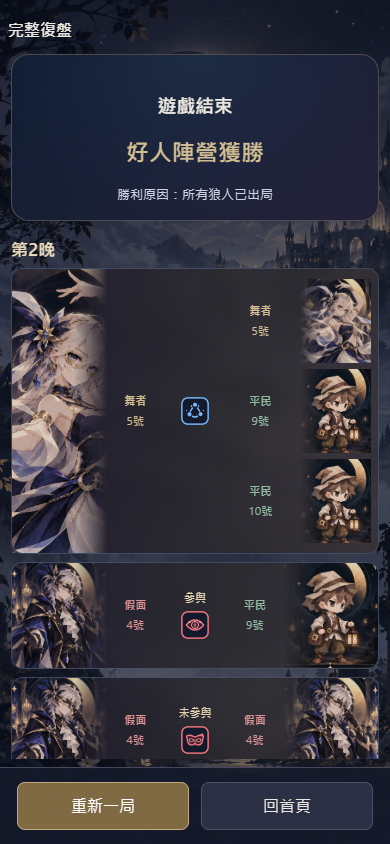
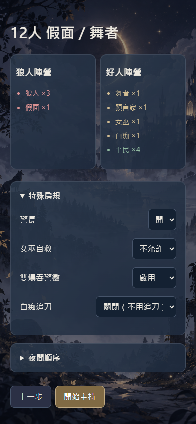

# 假面／舞者追加修正｜README 52.15／52.16 驗收報告

規格來源：main@5ed863f、App README@3943ffb。本輪修改既有 App，未改角色配置、正式角色圖鑑、其餘主持字幕或其他板子規則。

## 完成內容與 Bug 修正

- 假面板特殊房規統一「白痴追刀」，共用預女獵白的「關閉（不用追刀）／開啟（需要追刀）」；預設關閉。開局、規則視窗、翻牌勝負及存檔使用同一 idiotChase 值。
- v16 假面存檔及所有回退快照的 idiotCountsAlive 明確遷移到 idiotChase，舊值優先，避免原本開啟卻被舊預設 false 改成關閉。舊參數仍可讀，新局不再儲存兩套相互矛盾欄位。
- 第二晚起假面流程為睜眼 → 查驗選擇 → 獨立大字「-」／小字「有參與共舞」或「未參與共舞」結果頁 → 賦面／空過 → 閉眼；選擇頁不提前顯示結果。回退改選及刷新恢復正確。
- 不足三名合法共舞者仍完整保留三句舞者字幕；操作區提示無法使用技能，下一步有效，不產生共舞事件或參與歷史。
- 舞者選擇卡保留三人，不顯示圖示上方結果或底部白字。假面查驗使用正式紅色 icon-wolf-inspect.svg，精簡「參與／未參與」；賦面用原紅面具，只顯示「陣營反轉／未參與」，空過不顯示卡。
- 實際因共舞死亡才建立獨立「舞者 → 共舞 → 死者」卡，文字「共舞死亡」，展示順序在假面卡後、狼人刀前。狼刀實際結算仍優先，不為展示排序改變傷害時序。
- 狼刀提前終局時保留已選舞者／假面卡，隱藏未結算毒殺卡，沒有共舞死亡卡；可見卡不顯示「未結算（遊戲已結束）」，內部原有 executed／unsettled 狀態照實保留。
- 同一目標共舞與毒藥重疊時，保存各傷害事件並保留第一次實際死亡來源，不因後面的毒藥覆寫共舞死亡，也不重複計死者。此修正僅限假面板；其他板子的原結算不變。
- 復盤免刀精確顯示「共舞免刀」，移除「第N晚接手基本狼刀」等底部說明及占位；接刀時點仍保存在事件資料。
- 選板／圖鑑離開後重新進入回頂：先渲染與顯示頁面，才重設實際 overflow 容器。圖鑑分類保留，同一次開啟正常捲動不強制回頂；角色詳情視窗重新開啟也回頂，不清除主持資料。
- 舊查驗座位標記遷移為新紅色圖示，保持原 sequence 堆疊順序；舊查驗復盤也用正式紅色圖示。舊復盤若已有明確共舞死因及當時角色快照，可產生展示卡；缺少正式死亡來源時不反推或補造。
- 存檔 v17 相容 v1～v16及歷史快照；快取 council-v17-1，新增 SVG 納入原有靜默分階段快取。原金色查驗、面具 SVG、角色 PNG 原檔不變。

## 本輪實測

- **616／616 項測試通過，0 失敗**；新增 9 項定向覆蓋房規／歷史遷移、查驗結果頁、三人不足、復盤條件／排序、狼刀提前終局、舊事件及圖示堆疊。
- **三輪壓力 864 局／95,704 次公開 API 操作**，24 配置全部正常終局；序列化存檔最大 3,776,641 UTF-8 bytes。測試包括回退重播、刷新、房規、技能及重新一局。
- **33 局完整 DOM 黑箱／3,030 次操作**（24 配置＋9 特殊情境），0 JavaScript 錯誤；圖鑑、候選人、回退／刷新、重新一局、原 52 項離線素材回歸通過。
- 新流程五尺寸定向 DOM 通過：結果頁大／小字、兩種 SVG、回退、刷新、免刀後毒殺、無底部白字／精簡復盤；完成頁版型測試使用已執行事件 fixture，真實完整終局由全板黑箱另測。
- 五尺寸合計**選板重入 60 次、圖鑑重入 15 次**，回頂、分類保留、同次開啟正常捲動、兩種白痴追刀選項及主持存檔不變均通過。
- 新紅色 SVG 五尺寸斷線／刷新驗證通過；58 素材 cache-manifest 摘要及原分階段快取測試通過。
- 修改 JavaScript 語法與 git diff --check 通過。本專案沒有獨立 TypeScript／打包建置；沿用既有 Node 22 靜態 App 工作流程。

尺寸：320×568、390×844、844×390、768×1024、1024×768。

## 對照驗收

| 項目 | 證據／狀態 |
|---|---|
| MD-23～24 | 房規共用選項／預設，翻牌模式，v16存檔與全部歷史快照遷移 |
| MD-25～27 | 結果頁、回退重選、刷新；主持完整結果與復盤短字分開；Drive紅色SVG原檔 |
| MD-28～30 | 三人不足不漏台詞／不新增事件；三人卡無說明、空賦面無卡、查驗／賦面精簡文字 |
| MD-31～33 | 真實共舞死亡獨立卡、展示順序、狼刀提前終局與內部未結算狀態、同目標多來源及舊板回歸 |
| MD-34～35 | 「共舞免刀」與無底部接刀說明；其他正常事件／技能不變 |
| UI-01～04 | 五尺寸反覆進出、實際內層容器、正常捲動與主持資料保存 |

## 實際修改檔案

public/app.js、engine.js、data.js、index.html：共用房規、v17遷移、結果頁、完整舞者字幕及頁面重入。

public/night.js、records.js、recap.js：實際死亡來源、事件顯示篩選／排序、共舞死亡卡、精簡文字／圖示；保留獨立正式傷害與勝負引擎。

public/sw.js、cache-manifest.js、skills/icon-wolf-inspect.svg：新增正式SVG及新版快取。styles、正式角色原圖與原金色／面具SVG未修改。

test/masquerade-followup.test.js、scripts/followup-ui.mjs：新增定向驗證與反覆重入／離線驗證；test/masquerade.test.js、scripts/masquerade-ui.mjs更新已被追加定稿取代的舊預期。其餘test/beauty、classic、complete-recap、engine、nightmare、pwa、readme48，以及scripts/cache-regression、next-ui-regression、ui-regression、verify-deployment僅更新存檔／快取或正式站驗收。

## 限制與優化建議

實體 iPhone Safari、安裝 iOS PWA、Android、真實雙指縮放、動態工具列及長局存儲效能仍待真機驗收。沿用使用者先部署供真機驗收的授權，不把桌面模擬或部署成功宣稱為真機通過。

本輪最大全局history序列化已超過3 MB，建議下一輪量測真機容量與序列化／回退耗時後討論快照瘦身；本輪保留快照與回退語義，未做未核准結構更換。

## 執行與部署

Node.js 22 以上：npm test、npm start。額外壓力：STRESS_SEEDS=12，STRESS_OFFSET分別0／1000／2000，執行node --test test/stress.test.js。瀏覽器驗證使用可取得的Playwright及隔離Edge，執行scripts/followup-ui.mjs、masquerade-ui.mjs、ui-regression.mjs；不使用個人瀏覽器資料。

程式提交 d2f4dd74aa52be922d100b04f0ff66100eef3b50（feat/eclipse-host-app）。[測試 CI](https://github.com/jia0796/wolf_Emcee/actions/runs/38266543217)／[部署](https://github.com/jia0796/wolf_Emcee/actions/runs/38266543473) 成功；[正式站](https://jia0796.github.io/wolf_Emcee/) 30 項程式／素材 SHA256 核對一致，白痴追刀、首夜登記、房規保存、刷新、計時器、特殊分類及 council-v17-1 快取通過，0 JavaScript 錯誤；main只更新規格／報告，不合併App程式。

## 實際DOM截圖

截圖為桌面隔離Edge，不是真機Safari。復盤截圖是已執行事件的完成頁fixture，不用圖中的示意勝負替代完整對局測試。
